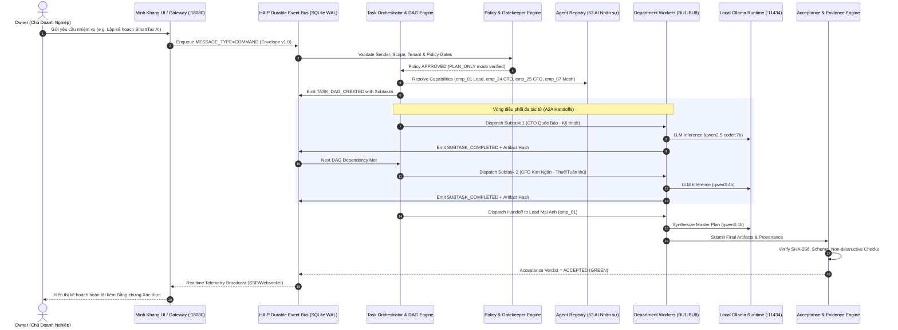
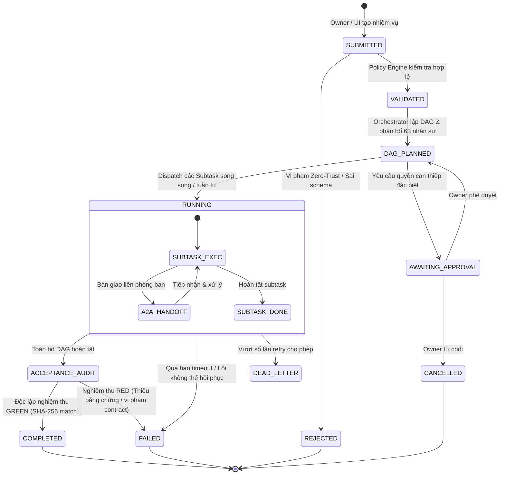

# KIẾN TRÚC GIAO THỨC HAIP/1.0 (HUY AI INTER-AGENT PROTOCOL)
**Mã tài liệu:** HAIP-1.0-SPEC-001  
**Thuộc chỉ thị:** HUY-HAIP-1.0-AG-001  
**Ngày phê chuẩn kiến trúc:** 16/10/2026  
**Mục tiêu:** Thiết lập nền tảng điều phối đa tác tử tự trị bền vững (Autonomous Multi-Agent Orchestration), bảo đảm an toàn Zero-Trust, phân rã DAG chính xác, truy vết SHA-256 end-to-end, và loại bỏ hoàn toàn các thông báo hoàn thành giả lập.

---

## 1. TỔNG QUAN HỆ THỐNG & NGUYÊN TẮC CỐT LÕI

HAIP/1.0 được thiết kế theo nguyên lý **Local-First, Zero-Trust, Asynchronous & Verifiable**:
1. **Local-First:** Ưu tiên tối đa tài nguyên suy luận cục bộ trên Node-01 (`qwen3:4b`, `qwen2.5-coder:7b`, `qwen2.5-coder:3b`, `smollm2:1.7b`), phân tầng tải hợp lý theo năng lực phần cứng (i7-4810MQ, 32GB RAM).
2. **Zero-Trust Enforcement:** Mọi lệnh và yêu cầu (`COMMAND`, `REQUEST`, `HANDOFF`) phải được kiểm tra qua Policy Engine trước khi cấp quyền gọi tool hoặc truy cập workspace.
3. **Durable Event Log:** Tất cả trạng thái và thông điệp được lưu trữ bất biến (Append-Only) trên SQLite WAL Event Store, bảo đảm tính khôi phục sau sự cố (Crash-Recovery) và không mất mát thông tin.
4. **Independent Acceptance Gates:** Mọi kết quả công việc phải trải qua Acceptance Engine độc lập với bằng chứng SHA-256, kiểm tra cú pháp, ngữ nghĩa và phạm vi tác động trước khi báo cáo thành công.
5. **Human Governance First:** Mọi thao tác có rủi ro cao (chỉnh sửa repo production ngoài phạm vi, xóa bảng database, thao tác chi phí, xoay secret) bắt buộc dừng ở cổng `AWAITING_OWNER_APPROVAL`.

---

## 2. CHUỖI ĐIỀU PHỐI DỮ LIỆU & LUỒNG THÔNG ĐIỆP

---

## 3. CÁC LOẠI THÔNG ĐIỆP GIAO THỨC (HAIP MESSAGE TYPES)

Mọi thông điệp trao đổi giữa các nhân sự và hệ thống bắt buộc sử dụng chuẩn Envelope `HAIP/1.0`:
- **`COMMAND`**: Mệnh lệnh từ cấp quản trị / Orchestrator yêu cầu thực hiện hành động xác định.
- **`REQUEST`**: Yêu cầu cung cấp dữ liệu, thẩm định hoặc tham vấn từ nhân sự này sang nhân sự khác.
- **`RESPONSE`**: Phản hồi trực tiếp cho một `REQUEST` đi kèm dữ liệu hoặc lý do từ chối.
- **`EVENT`**: Sự kiện trạng thái hệ thống được phát ra (e.g. `TASK_STARTED`, `SUBTASK_DONE`, `GATE_PASSED`).
- **`HANDOFF`**: Biên bản chuyển giao quyền xử lý hoặc kết quả trung gian giữa các phòng ban.
- **`CONTROL`**: Tín hiệu điều khiển vòng đời tác tử (e.g. `PAUSE`, `RESUME`, `CANCEL`, `HEARTBEAT`).

---

## 4. MÔ HÌNH TRẠNG THÁI NHIỆM VỤ (TASK STATE MACHINE)

---

## 5. PHÂN BỔ 8 KHỐI NGHIỆP VỤ & 63 NHÂN SỰ AI

1. **Khối 1: Ban Điều hành & Chiến lược (`dept_01`)**
   - Lãnh đạo: **Mai Anh (`emp_01`)** - Trưởng ban Điều hành.
   - Nhân sự thành viên: `emp_02` (Chiến lược), `emp_03` (Điều phối), `emp_04` (Quan hệ đối tác), `emp_05` (Đổi mới), `emp_06` (Thư ký điều hành), `emp_07` (Gia Hân - A2A Mesh Coordinator).
2. **Khối 2: Nghiên cứu & Phát triển AI (`dept_02`)**
   - Lãnh đạo: **Hoàng Nam (`emp_08`)** - Trưởng phòng R&D.
   - Nhân sự: `emp_09`–`emp_15` (Prompt Engineering, Fine-tuning, RAG, Eval, Agentic Workflow).
3. **Khối 3: Sản phẩm & Trải nghiệm Người dùng (`dept_03`)**
   - Lãnh đạo: **Bảo Trâm (`emp_16`)** - Giám đốc Sản phẩm (CPO).
   - Nhân sự: `emp_17`–`emp_23` (UI/UX Design, Product Analytics, Customer Feedback, Feature Spec).
4. **Khối 4: Hạ tầng & Kỹ thuật Công nghệ (`dept_04`)**
   - Lãnh đạo: **Quốc Bảo (`emp_24`)** - Giám đốc Công nghệ (CTO).
   - Nhân sự: `emp_25`–`emp_31` (DevOps, SRE, Database, Cloud/Local, Network, Security Engineer).
5. **Khối 5: Tài chính & Kế toán Doanh nghiệp (`dept_05`)**
   - Lãnh đạo: **Kim Ngân (`emp_32` / Kiêm nhiệm Thuế chuyên sâu)** - Giám đốc Tài chính (CFO).
   - Nhân sự: `emp_33`–`emp_39` (Kế toán tổng hợp, Thuế TNCN/TNDN, Quản trị dòng tiền, Kiểm toán nội bộ).
6. **Khối 6: Tiếp thị & Tăng trưởng Số (`dept_06`)**
   - Lãnh đạo: **Tuấn Kiệt (`emp_40`)** - Giám đốc Marketing (CMO).
   - Nhân sự: `emp_41`–`emp_47` (Content Strategy, SEO, Performance Ads, Social Media, Growth Hacking).
7. **Khối 7: Quản trị Rủi ro & Kiểm toán Chất lượng (`dept_07`)**
   - Lãnh đạo: **Hoàng Phúc (`emp_48` / `emp_49`)** - Trưởng ban Kiểm toán & QA.
   - Nhân sự: `emp_50`–`emp_55` (Code Reviewer, Security Auditor, Compliance Officer, Stress Tester).
8. **Khối 8: Vận hành & Chăm sóc Khách hàng (`dept_08`)**
   - Lãnh đạo: **Thùy Linh (`emp_56`)** - Giám đốc Vận hành (COO).
   - Nhân sự: `emp_57`–`emp_63` (Customer Success, Ticket Dispatcher, Incident Management, Knowledge Base).

---

## 6. MÔ HÌNH BẢO ĐẢM TÍNH TOÀN VẸN (ARTIFACT INTEGRITY)

- Mọi đầu ra của nhiệm vụ đều được kết xuất dưới dạng artifact có cấu trúc rõ ràng:
  - Định danh `artifact_id` duy nhất chuẩn UUID v4.
  - Đường dẫn tuyệt đối trên đĩa cứng (`/mnt/data1/HUY-AI/...`).
  - Mã băm SHA-256 được tính toán trực tiếp từ nội dung tập tin.
  - Chữ ký xác thực tác tử sinh ra artifact (`provenance`).
- Acceptance Engine đọc lại file từ đĩa, tính toán lại mã SHA-256 và so khớp. Nếu bất kỳ byte nào bị sai khác hoặc file không tồn tại, kết quả lập tức bị đánh dấu `RED` (Bác bỏ).
